# Varjota (CE): estudo político-eleitoral, 2020 a 2026, com projeção para 2028

> **Fonte:** Portal de Dados Abertos do TSE (arquivos `votacao_candidato_munzona`, `votacao_partido_munzona`, `detalhe_votacao_munzona`, `votacao_secao`, `consulta_cand`, `bem_candidato` e `perfil_eleitorado`), baixados em 13/11/2026. Município TSE 98574, 65ª Zona Eleitoral.
> **Como reproduzir:** `scripts/analise.py`. Todos os números estão em `dados/metricas.json`. Os gráficos estão em `graficos/`.
> **Aviso:** o que está marcado como **leitura** ou **hipótese** é interpretação dos números. Precisa ser confirmado por quem conhece a política local.

---

## 0. Resumo em 10 linhas

1. **Elmo Monte foi reeleito em 2024 com 64,3%.** Em 2020 ele tinha vencido com 53,1%. A margem passou de **830 votos para 3.959**.
2. **Elmo venceu mesmo trocando de partido e de vice.** Saiu do PDT para o PSB. A vice eleita em 2020, Loura do Povo, foi para a chapa adversária (PP), e ele ainda assim ampliou a vantagem.
3. **A Câmara virou.** Em 2020 a base do prefeito elegeu 5 vereadores e a oposição 6, ou seja, a oposição tinha maioria no papel. Em 2024 o placar ficou **8 a 3 para a base**.
4. **O quociente eleitoral subiu de 1.199 para 1.252 votos** por cadeira. As vagas continuam 11.
5. **Houve menos candidatos.** Foram 48 candidatos a vereador em 2020 e 34 em 2024. As listas na urna passaram de 4 para 3, e o número de candidatos com menos de 100 votos caiu de 19 para 8.
6. **A oposição perdeu seus puxadores de voto.** Os 5 eleitos de 2020 que não concorreram em 2024 eram todos da oposição, e somavam 3.311 votos.
7. **A força do partido pesou mais que o voto pessoal.** Em 2024, Eudes do Croatá (MDB) se elegeu com 280 votos, enquanto Aristeu Linhares (PSB) ficou de fora com 553.
8. **As mulheres na Câmara passaram de 2 para 5** entre os 11 vereadores.
9. **Em 2026, Varjota votou diferente do estado.** Ciro Gomes teve 58,1% para governador, contra 41,6% de Elmano, que foi eleito no Ceará. Para o Senado, os quatro principais nomes ficaram entre 23% e 27%. **Leitura:** a máquina local transfere pouco voto em eleição estadual.
10. **2028 será sucessão aberta**, porque Elmo está no segundo mandato. O quociente projetado fica entre **1.160 e 1.250 votos**. Cada partido pode lançar até 12 candidatos a vereador. O tamanho da vitória de 2024 não deve se repetir automaticamente.

---

## 1. Eleitorado: quem vota em Varjota

| Ano | Eleitores aptos | Compareceram | Comparecimento |
|---|---:|---:|---:|
| 2020 (municipal) | 16.437 | 13.726 | 83,5% |
| 2022 (geral) | 16.757 | 12.855 | 76,7% |
| 2024 (municipal) | 16.213 | 14.374 | **88,7%** |
| 2026 (geral) | 15.991 | 13.452 | 84,1% |

**O que os números dizem**

- **O eleitorado encolhe desde 2022.** Foram 766 eleitores a menos em quatro anos (−4,6%). Para 2028, o mais provável é algo entre **15.600 e 16.100 aptos**.
- **A eleição municipal mobiliza muito mais.** Em 2024 houve 872 abstenções a menos que em 2020, mesmo com 224 aptos a menos. Esse eleitor extra apareceu justamente na eleição em que o prefeito ampliou a vantagem. **Leitura:** a mobilização foi da máquina governista.
- **Perfil etário (2020 → 2024):**
  - 16–24 anos: 3.106 → 2.850 (−256)
  - 25–44 anos: 6.565, praticamente estável
  - 45–59 anos: 3.305 → 3.585 (+280)
  - 60+ anos: 3.466 → 3.213
  - **Leitura:** há menos jovens no cadastro e o centro de gravidade do eleitorado é a faixa de 25 a 59 anos.
- **Escolaridade:**
  - Analfabetos: 10,0% → 7,2%
  - Ensino médio completo: 18,4% → 21,2%
  - Mais da metade do eleitorado ainda não concluiu o ensino fundamental.
  - **Leitura:** comunicação de proximidade (rádio, visita, liderança comunitária, WhatsApp em áudio) pesa mais que debate programático.
- **Gênero:** o eleitorado é 50,4% feminino.

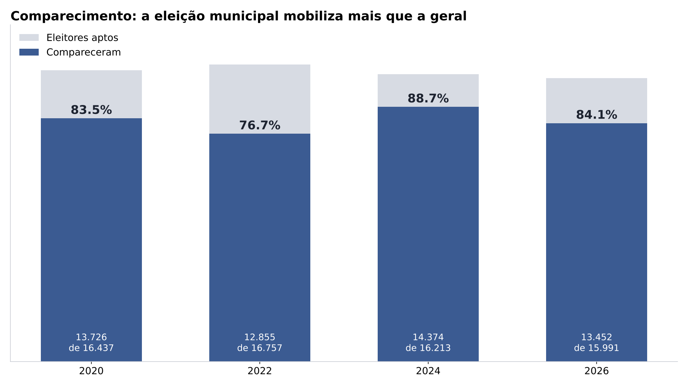
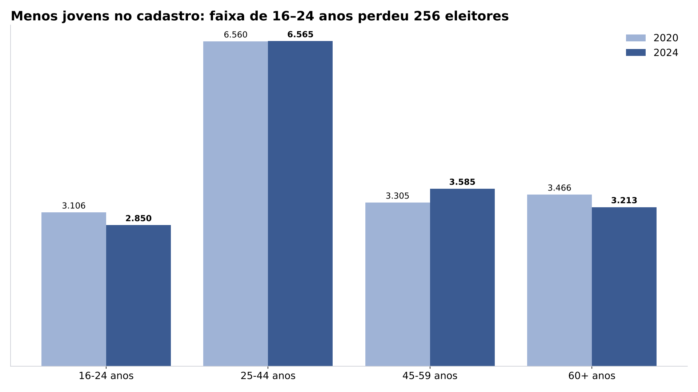

---

## 2. Prefeito: de vitória apertada a vitória larga

| | 2020 | 2024 |
|---|---|---|
| Vencedor | **Elmo Monte (PDT)**, 7.068 votos (53,1%) | **Elmo Monte (PSB)**, 8.914 votos (64,3%) |
| Derrotado | Rosa Paulino (MDB), 6.238 votos (46,9%) | Silvino Oliveira (MDB), 4.955 votos (35,7%) |
| Coligação vencedora | PSB / PDT / PT / PTB | PSB / Republicanos / União / Federação PT-PCdoB-PV |
| Coligação derrotada | PL / MDB / PSL | PP / MDB |
| Margem | 830 votos (6,2 pontos) | **3.959 votos (28,6 pontos)** |
| Vice do vencedor | Loura do Povo (PDT) | Dr. Erivaldo Mororó (Republicanos) |

**Entrelinhas**

- **Elmo ganhou 1.846 votos e a oposição perdeu 1.283** entre as duas eleições. A vitória maior veio de crescimento próprio e de encolhimento do adversário ao mesmo tempo.
- **A vice mudou de lado.** Loura do Povo foi eleita vice em 2020 na chapa de Elmo e em 2024 concorreu a vice na chapa adversária, pelo PP. Mesmo assim a oposição caiu 11 pontos. **Leitura:** em 2024 o voto seguiu a gestão e a máquina, não o nome da vice.
- **A troca PDT → PSB acompanha o movimento estadual** do grupo ligado a Cid Gomes. Os vereadores da base migraram juntos e ninguém se perdeu no caminho.
- **A coligação governista ficou maior.** Entraram Republicanos e União. A oposição perdeu o PL, que em 2020 tinha eleito um vereador.

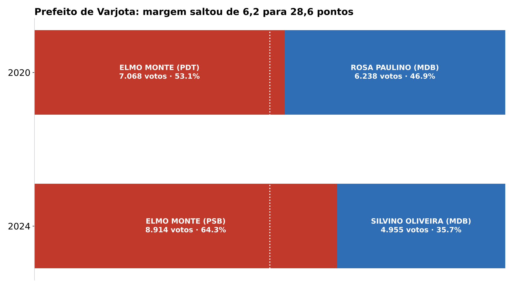

### Geografia do voto (por local de votação)

- **2020:** a oposição venceu em **7 de 30 locais**, entre eles E.E.F. Odilon Nobre, Tereza Aragão Ximenes, Creche João Balbino, Naiara Macedo, Creche Balneário, Sítio Angelim e Sítio Jatobá.
- **2024:** a oposição **não venceu em nenhum dos 28 locais**.
- **Onde Elmo mais cresceu:**
  - E.E.F. Francisca Ezequiel de Sousa (Sítio Jatobá, zona rural): +29,8 pontos
  - E.E.I.F. Manoel Rodrigues Tavares (Sítio Angelim, zona rural): +24,4 pontos
  - Secretaria de Educação/Assistência: +17,4 pontos
  - CRAS/Casa do Idoso: +17,3 pontos
  - Creche Balneário: +17,0 pontos
- **Onde Elmo menos cresceu (são os redutos de resistência para 2028):**
  - Melquíades Muniz Farrapo (Transval, zona rural): +4,3 pontos
  - Vicente Trajano de Mesquita (Olho d'Água dos Trajano, zona rural): +4,5 pontos
  - Francisco Pereira da Costa: +5,6 pontos
  - Liceu Waldir Leopércio, segundo maior local da cidade: +6,2 pontos
  - Centro Digital: +7,1 pontos
- **Leitura:** a virada veio sobretudo de comunidades rurais que eram da oposição e de locais ligados a equipamentos sociais. O centro urbano (Liceu) cresceu pouco. Uma oposição em 2028 deveria começar por esses locais de baixo avanço.

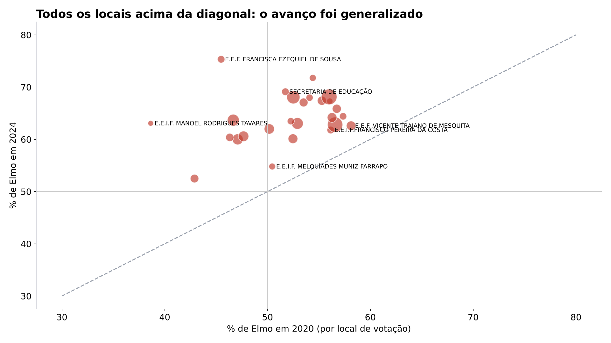

---

## 3. Câmara Municipal: quociente, sobras e listas

### Como a conta funciona

1. **Quociente eleitoral (QE)** = votos válidos para vereador ÷ 11 cadeiras. Se a fração for maior que 0,5, arredonda para cima.
2. **Quociente partidário (QP)** = votos do partido (nominais + legenda) ÷ QE, sem contar a fração. É o número de cadeiras "cheias" de cada partido.
3. **Sobras:** as cadeiras que restam vão para a maior média, calculada como votos do partido ÷ (cadeiras já obtidas + 1). Só disputam sobras os partidos com pelo menos 80% do QE.
4. **Regra individual:** para ser eleito, o candidato precisa ter pelo menos 10% do QE. Para ocupar uma vaga de sobra, a lei exige 20% do QE.
5. **Federação conta como um partido só.** Em 2024, PT, PCdoB e PV formaram uma única lista.

### 2020

| | |
|---|---|
| Válidos para vereador | 13.184 (12.576 nominais + 608 de legenda) |
| **Quociente eleitoral** | **1.199** |
| Candidatos | 48 em 4 listas: MDB 16, PDT 13, PT 10, PL 9 |

| Lista | Votos | Cadeiras pelo QP | Cadeiras nas sobras | **Total** |
|---|---:|---:|---:|---:|
| MDB | 5.348 | 4 | +1 | **5** |
| PDT | 4.066 | 3 | +1 | **4** |
| PT | 1.944 | 1 | – | **1** |
| PL | 1.826 | 1 | – | **1** |

- **Sobras:** a 1ª sobra foi para o MDB, com média 1.069,6. A 2ª foi para o PDT, com média 1.016,5. **O PT ficou a 90 votos de levar a última cadeira**, que acabou com Djinha (PDT).
- **Placar:** base 5 (PDT 4 + PT 1) contra oposição 6 (MDB 5 + PL 1).
- **Eleitos:** Roberto do Garrone (PT, 835), Antunino Martins (MDB, 818), Gonçalinho (PDT, 784), Molim (MDB, 769), Jô do Silvino (MDB, 737), Regio Ximenes (PDT, 726), Anchieta (MDB, 575), Aristeu Linhares (PDT, 562), Djinha (PDT, 539, por média), Edgar Procópio (PL, 522), Marcos Cesar (MDB, 465, por média).
- Menos votado eleito: 465. Mais votado não eleito: João Paulo do Ararinha (PDT), com 488.

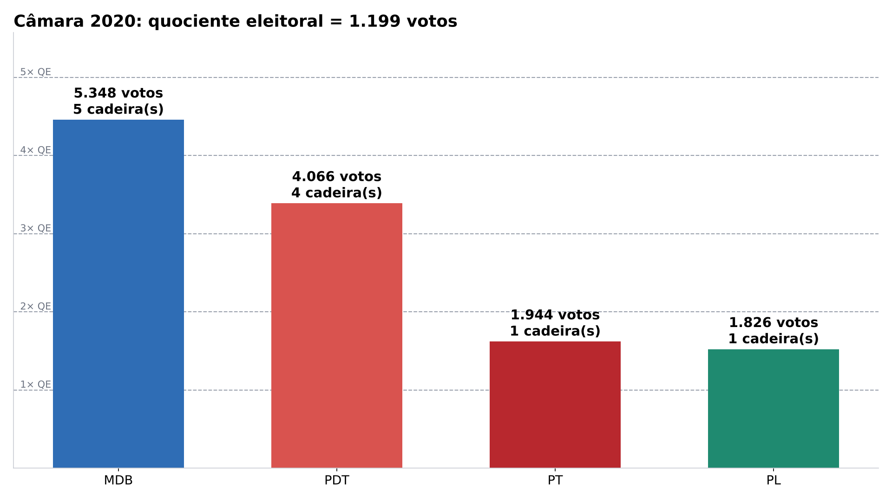

### 2024

| | |
|---|---|
| Válidos para vereador | 13.768 (13.425 nominais + 343 de legenda) |
| **Quociente eleitoral** | **1.252** |
| Barreira de 80% para sobras | 1.002 |
| Mínimo individual (10% do QE) | 126 |
| Candidatos | 34 registrados (33 com votos) em 3 listas: PSB 12, MDB 12, Federação PT 10 |

| Lista | Votos | Cadeiras pelo QP | Cadeiras nas sobras | **Total** | Votos por cadeira |
|---|---:|---:|---:|---:|---:|
| PSB | 6.403 | 5 | – | **5** | 1.281 |
| MDB | 3.979 | 3 | – | **3** | 1.326 |
| Fed. PT/PCdoB/PV | 3.386 | 2 | +1 | **3** | 1.129 |

- **Sobra:** a única sobra foi para a Federação, com média 1.128,7, contra 1.067,2 do PSB e 994,8 do MDB. **O PSB precisaria de mais 371 votos para fazer a 6ª cadeira.** Essa vaga teria ido para Aristeu.
- **Placar:** base 8 (PSB 5 + PT 3) contra oposição 3 (MDB).
- **Eleitos:** Rosa Paulino (MDB, **1.774**), Eudes Mesquita (PSB, 992), Gonçalinho (PSB, 915), Regio Ximenes (PSB, 884), Patrícia Ximenes (PT, 847), Lucas da Célia (MDB, 834), Roberto do Garrone (PT, 783), Fransquinha do Edvard (PSB, 682), Djinha (PSB, 672), Professora Inara (PT, 599, por média), Eudes do Croatá (MDB, 280).
- **O efeito lista fica claro nos números:**
  - O MDB elegeu Eudes do Croatá com **280 votos**.
  - No PSB, Aristeu (553), Anchieta (485) e Diana do João Paulo (478) ficaram como suplentes.
  - Disputar dentro de uma lista forte é mais difícil: o 5º eleito do PSB teve 672 votos.
- **O voto ficou mais concentrado:**
  - Em 2020, 55,6% dos votos válidos foram para eleitos. Em 2024 foram 67,3%.
  - Dentro da lista do MDB, os 3 mais votados fizeram 75% dos votos, e só Rosa Paulino respondeu por 45%.
  - No PSB, os 3 primeiros fizeram 45%. A lista do PSB é mais equilibrada.

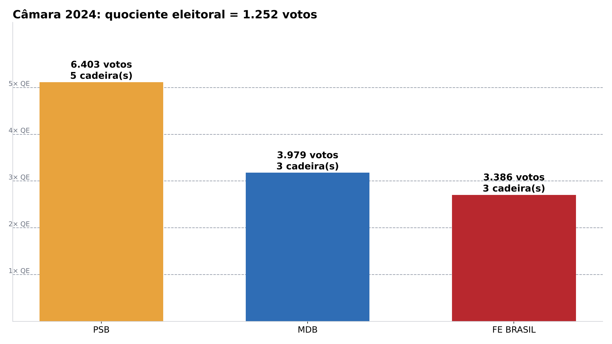
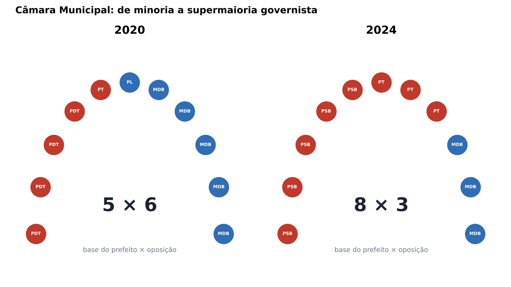
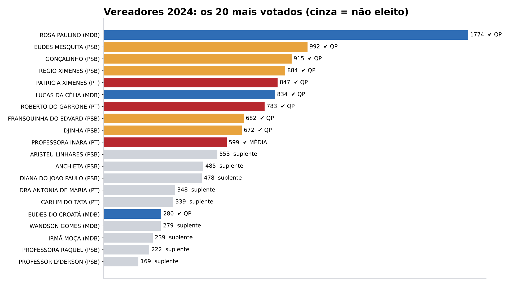

### Renovação e perfil

- **Quem voltou:** dos 11 eleitos em 2020, 6 concorreram de novo e 4 foram reeleitos (Gonçalinho, Regio, Djinha e Roberto). **7 dos 11 vereadores de 2024 são novos na Câmara.**
- **Quem não concorreu:** Antunino, Molim, Jô do Silvino e Marcos Cesar, do MDB, e Edgar Procópio, do PL. Todos eram da oposição.
- **Mulheres:** eram 15 candidatas e 2 eleitas em 2020. Em 2024 foram 13 candidatas e **5 eleitas** (Rosa, Patrícia, Fransquinha, Djinha e Inara).
- **Idade:** a média de idade dos eleitos ficou estável, em torno de 48 anos.

---

## 4. Migrações partidárias: o mapa de quem foi para onde

O cruzamento foi feito pelo título de eleitor, que identifica o mesmo candidato nas duas eleições.

| Nome | 2020 | 2024 | Observação |
|---|---|---|---|
| Elmo Monte | PDT (prefeito eleito) | PSB (prefeito reeleito) | Trouxe o grupo inteiro |
| Gonçalinho, Regio, Djinha, Aristeu, Fransquinha | PDT | PSB | Bancada migrou em bloco |
| **Loura do Povo** | PDT (vice eleita) | **PP (vice da oposição)** | Ruptura com o grupo |
| **Anchieta** | MDB (vereador eleito) | **PSB** | Vereador da oposição aderiu à base e não se reelegeu |
| Lyderson, Pexé | MDB (suplentes) | PSB | Adesão à base |
| Carlim do Tatá | MDB (suplente) | PT | Adesão à base |
| Irmã Fábia | PL | PT | Adesão à base |
| Adriano Paiva, Irmã Moça | PL | MDB | O PL local foi absorvido pelo MDB |
| Rosa Paulino | MDB (prefeita, derrotada) | MDB (vereadora, a mais votada) | A líder da oposição desceu para a Câmara |

**Leitura:** o fluxo foi quase todo **da oposição para a base**. É o padrão de prefeito forte no segundo mandato. A única grande saída da base foi a da vice. O PL deixou de existir como lista local.

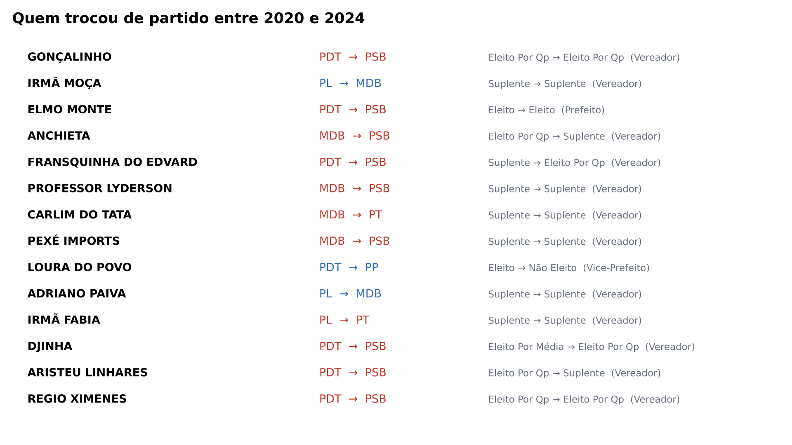

---

## 5. Patrimônio declarado ao TSE

São os valores informados pelos próprios candidatos no registro. Servem só como contexto e não indicam nada além disso.

- **2020:** R$ 3,03 milhões declarados no total, por 27 candidatos. Os maiores valores foram de Elmo Monte (R$ 685 mil), Cleone Ximenes (R$ 611 mil), Loura do Povo (R$ 553 mil) e Rosa Paulino (R$ 458 mil).
- **2024:** R$ 6,61 milhões declarados no total, por 27 candidatos. Os maiores valores foram de Loura do Povo (R$ 1,99 milhão), Eudes Mesquita (R$ 1,13 milhão), Dr. Erivaldo Mororó (R$ 800 mil) e Elmo Monte (R$ 796 mil).

---

## 6. Contexto: como Varjota vota nas eleições gerais

| | 2022 | 2026 |
|---|---|---|
| Presidente, 2º turno | Lula 72,3% × Bolsonaro 27,7% | Lula 66,5% × Flávio Bolsonaro 33,5% |
| Governador | Elmano (PT) 45,5% · Roberto Cláudio (PDT) 31,6% · Wagner 22,8% | **Ciro Gomes (PSDB) 58,1%** · Elmano (PT) 41,6% |
| Senado | Camilo 78,9% | Wagner 26,6% · Cid 25,3% · Alcides 24,6% · Luizianne 23,2% |
| Dep. estadual, mais votado | Lia Gomes (PDT), 34,3% | Lia Gomes (PSB), 30,1% |
| Dep. estadual, 2º | Danniel Oliveira (MDB), 22,2% | Danniel Oliveira (MDB), 22,1% |
| Dep. federal, mais votado | Leônidas Cristino (PDT), 33,8% | Yury do Paredão (MDB), 19,0% |
| Dep. federal, 2º | Eunício (MDB), 26,6% | Denis Bezerra (PSB), 16,7% |

**Entrelinhas de 2022 e 2026**

- **Os dois blocos locais aparecem no voto para deputado estadual.** Lia Gomes (grupo do prefeito) e Danniel Oliveira (MDB) repetem 30–34% e 22% nas duas eleições. Quase não houve mudança.
- **Para deputado federal, a base se divide e a oposição se concentra.** Em 2026, Yury do Paredão (MDB) foi o mais votado. Já os nomes do PSB repartiram o voto do grupo: Denis com 16,7%, Idilvan com 8,1%, Tainah com 4,7% e Robério com 3,2%, cerca de 33% somados. **Leitura:** a base tem muitos aliados para atender, enquanto a oposição tem um só nome por cargo.
- **No governo do estado, Varjota votou contra o eleito.** Ciro venceu em Varjota mesmo com a base local do prefeito aliada ao PT no plano estadual. Elmano caiu de 45,5% em 2022 para 41,6% em 2026. **Hipóteses:**
  - (a) o voto em Ciro na região de Sobral passa por cima dos partidos;
  - (b) parte da base local apoiou Ciro, ou ficou neutra.
  - Vale apurar qual liderança fez campanha para quem, porque isso pode reorganizar as alianças de 2028.
- **No Senado, o voto se dividiu quase igual entre os quatro nomes.** Cid Gomes, referência estadual do PSB, ficou em 2º lugar no município. **Leitura:** o eleitor de Varjota separa o voto local do voto estadual.
- **O bolsonarismo cresceu.** Lula caiu de 72,3% para 66,5% no 2º turno, cerca de 6 pontos. Isso abre espaço para uma lista de direita (PL ou Novo) em 2028, que em 2024 não existiu.

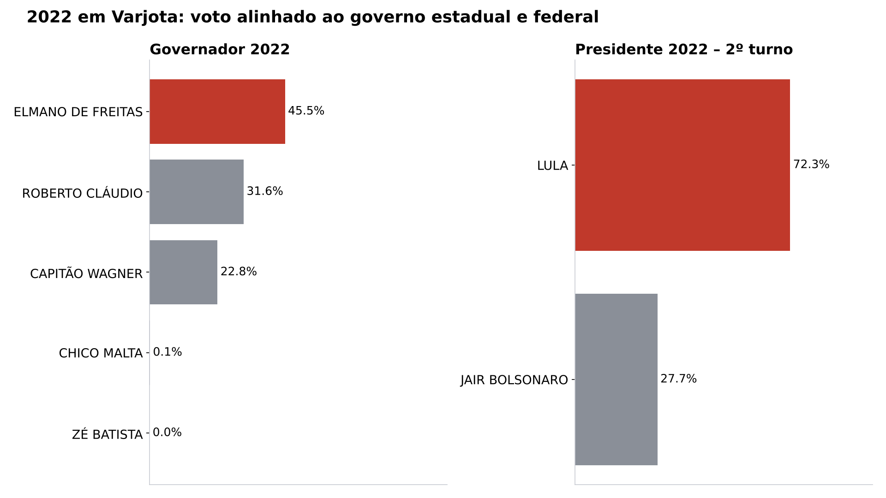
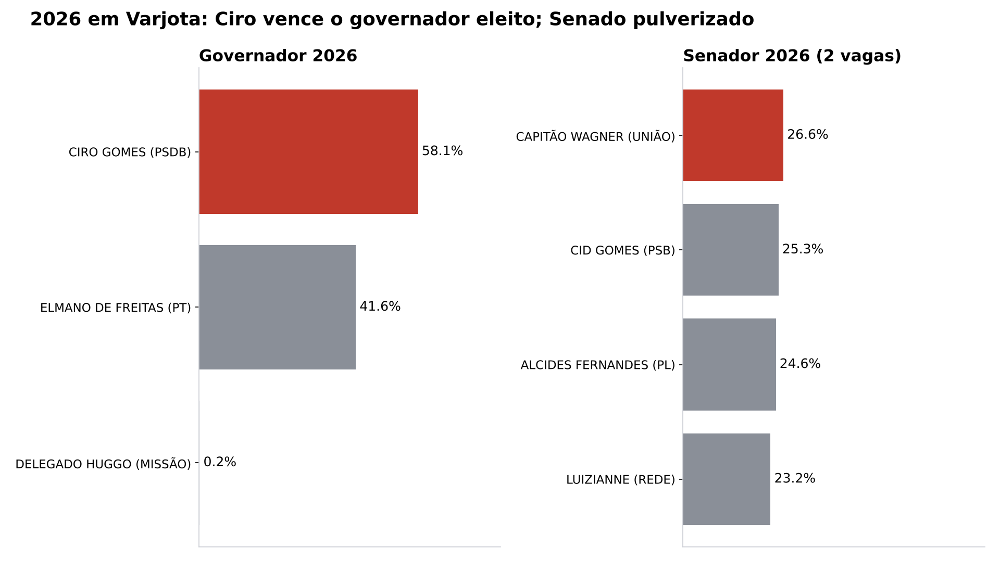

---

## 7. As entrelinhas: 12 achados que não aparecem na manchete

1. **A oposição tinha maioria em 2020 e não conseguiu usá-la.** Venceu a Câmara por 6 a 5 e quatro anos depois tinha 3 cadeiras. Parte dos vereadores mudou de lado (Anchieta) e os principais desistiram de concorrer.
2. **A oposição ficou dependente de uma pessoa só.** Rosa Paulino fez 45% de todos os votos do MDB para vereador. Se ela for candidata a prefeita em 2028, a lista do MDB perde cerca de 1.800 votos. Com o quociente próximo de 1.200, isso custaria uma ou duas cadeiras.
3. **O voto pessoal mais forte da cidade está na oposição.** Rosa (1.774) teve quase o dobro do vereador mais votado da base (Eudes Mesquita, 992). É um capital pessoal a considerar em 2028.
4. **A base pagou caro pela lista equilibrada do PSB.** O PSB teve 6.403 votos e fez 5 cadeiras. A Federação, com 3.386, fez 3. Faltaram 371 votos ao PSB para a 6ª. Para 2028, distribuir melhor os candidatos entre PSB e PT pode render uma cadeira a mais.
5. **Pequenas diferenças decidem cadeiras.** Em 2020 o PT perdeu a última vaga por 90 votos. Em 2024, os 371 votos que faltaram ao PSB equivalem a uma só seção grande.
6. **Houve menos candidatos sem chance real.** Os candidatos com menos de 100 votos caíram de 19 para 8. **Leitura:** os partidos montaram listas mais enxutas e competitivas.
7. **Quase ninguém usa o voto de legenda,** que caiu de 608 para 343. O eleitor de Varjota vota em pessoa, não em partido. Isso favorece candidatos com base comunitária ou familiar.
8. **Os apelidos de urna mostram onde está a base de cada candidato.** São referências a família e lugar ("do Garrone", "do Silvino", "do João Paulo", "do Croatá", "da Célia", "do Edvard", "do Ararinha"). Vale mapear qual família e qual comunidade cada nome representa.
9. **A abstenção caiu quando a eleição ficou desequilibrada.** Isso indica mobilização organizada (transporte, cabos eleitorais, programas sociais), não entusiasmo espontâneo. Os locais ligados a CRAS, Secretaria e creches tiveram avanços de 17 pontos ou mais.
10. **A zona rural decide a eleição.** As maiores viradas aconteceram em sítios e povoados (Jatobá e Angelim). Os locais em que Elmo menos cresceu também são rurais (Transval e Olho d'Água dos Trajano). A disputa de 2028 passa por essas comunidades.
11. **A vice saiu e a coligação cresceu.** Republicanos e União entraram e o novo vice é médico. **Leitura:** o vice de 2024 é candidato natural à sucessão em 2028, mas não tem voto próprio testado nas urnas.
12. **O eleitorado diminuiu e a maioria ficou mais barata.** Com cerca de 13.300 votos válidos em 2028, vencer para prefeito exige perto de 6.700 votos. Cada 100 votos virados entre os candidatos equivalem a 1,5 ponto de margem.

---

## 8. Projeção para 2028

### 8.1 Premissas

- **Eleitores aptos:** 15.600 (cenário baixo), 15.850 (central) ou 16.100 (alto). A base é a tendência 16.757 → 16.213 → 15.991.
- **Comparecimento:** 85,5%, 87,5% ou 89%. Em 2024 foi 88,7%, mas em 2028 não haverá prefeito disputando a reeleição.
- **Válidos para vereador sobre comparecimento:** 95,8%, a média de 2020 e 2024.
- **Cadeiras:** 11. Cada partido ou federação pode lançar até 12 candidatos (11 + 1).

### 8.2 Quociente e barreiras projetados

| Cenário | Comparecimento | Válidos (vereador) | **QE** | Barreira de 80% | 10% do QE | 20% do QE |
|---|---:|---:|---:|---:|---:|---:|
| Baixo | 13.338 | 12.778 | **1.162** | 930 | 117 | 233 |
| **Central** | 13.869 | 13.286 | **1.208** | 967 | 121 | 242 |
| Alto | 14.329 | 13.727 | **1.248** | 999 | 125 | 250 |

**Na prática:** um partido precisará de cerca de **1.200 votos por cadeira** e de **no mínimo cerca de 970 votos** para disputar as sobras. Uma lista com 12 nomes fortes, em média 110 votos por candidato, já passa da barreira.

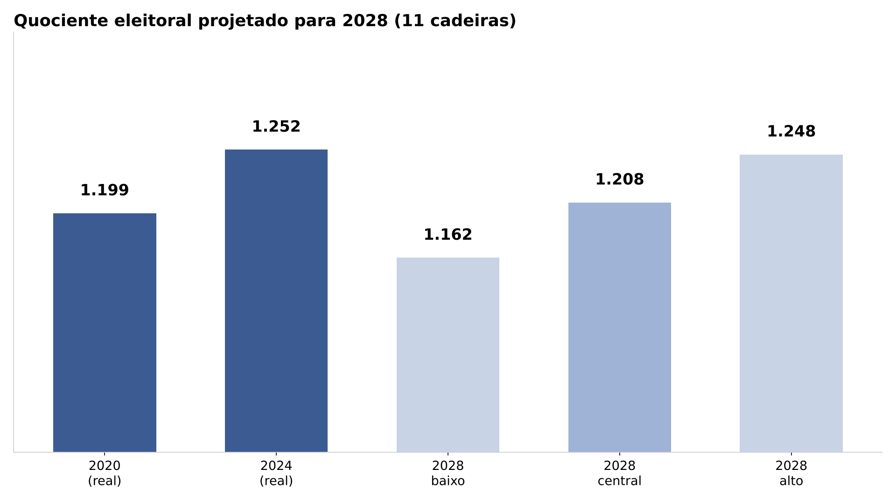

### 8.3 Quantos candidatos?

| | 2020 | 2024 | 2028 (estimativa) |
|---|---|---|---|
| Listas | 4 | 3 | **3 a 5** |
| Candidatos a vereador | 48 | 34 | **33 a 55** |
| Teto por partido | – | 12 | 12 |
| Candidatos a prefeito | 2 | 2 | **2 a 3** |

Com uma sucessão aberta, o normal é que mais partidos lancem lista própria para medir força: Republicanos, União, PL e PP. Com 5 listas cheias seriam 60 candidatos. Um número realista fica perto de 40 a 50.

### 8.4 Simulação de cadeiras (QE central de 1.208)

| Cenário | Divisão dos votos | Resultado |
|---|---|---|
| **A: continuidade** | PSB 45%, Federação PT 25%, MDB 30% | PSB 5, PT 3, MDB 3 (8 × 3, igual a 2024) |
| **B: fragmentação** (aliados com listas próprias) | PSB 33%, PT 20%, MDB 25%, Republicanos/União 12%, PL/PP 10% | PSB 4, PT 2, MDB 3, Rep/União 1, PL/PP 1 |
| **C: oposição cresce** (MDB herda a sucessão) | PSB 36%, PT 20%, MDB 38%, PP 6% | PSB 4, PT 2, **MDB 5**, PP 0 (base 6 × 5) |

**O que a simulação mostra:**

- O PP com 6% não chega à barreira de 80% e fica sem cadeira.
- Um partido novo **precisa de cerca de 970 votos para existir na Câmara**.
- Mesmo no cenário B, a base continua com maioria (7 ou 8 cadeiras), desde que Republicanos e União sigam aliados.

### 8.5 Prefeito em 2028: cenários

Elmo Monte não pode concorrer, porque já está no segundo mandato consecutivo.

| Cenário | Descrição | Faixa provável |
|---|---|---|
| **Continuidade unida** | Um só nome da base (vice, vereador forte do PSB ou do PT, ou alguém da família ou do secretariado), com a coligação de 2024 mantida | Base com 55–62% |
| **Base dividida** | PT ou Republicanos lançam candidato próprio. A divisão estadual entre Ciro e o PT pode chegar ao município | Disputa aberta, com 2 ou 3 candidatos |
| **Oposição unificada** | MDB com Rosa Paulino (o maior voto pessoal) ou um nome novo, somando PP e PL, e aproveitando o desgaste natural de 8 anos e o voto anti-PT de 2026 | Oposição com 42–50% |

**Variáveis a observar até 2028:**

- Quem o prefeito vai apontar como sucessor e se a base aceita o nome.
- Se Rosa Paulino concorre a prefeita ou fica na Câmara.
- Como o grupo de Ciro, o PSB de Cid e o PT de Elmano se arrumam no Ceará depois de 2026.
- O comportamento das comunidades rurais com baixo avanço governista (Transval, Olho d'Água dos Trajano) e do Liceu.
- A posição de Republicanos e União (lista própria ou federação).
- A evolução do eleitorado jovem (16–24 anos), que vem caindo.

---

## 9. Limitações

- O TSE não publica quem apoiou quem em 2026. As leituras sobre alianças precisam ser confirmadas em campo.
- Os locais de votação mudaram de numeração e de nome entre 2020 e 2024. Dois locais não têm par direto, e a comparação foi feita só nos 26 locais em comum.
- Os parentescos sugeridos pelos apelidos não foram verificados. São pistas, não fatos.
- As regras de sobras para 2028 (barreiras de 80/20 e a participação de todos os partidos na última fase) devem ser conferidas na resolução do TSE para a eleição.

---

## 10. Próximos passos sugeridos

1. Baixar a **prestação de contas** de 2020 e 2024 (receitas, despesas, doadores e custo por voto de cada candidato).
2. Cruzar **votos por seção** de cada vereador para mapear o reduto de cada um.
3. Levantar **filiações partidárias** no TSE (filiados por partido em Varjota) para medir a capacidade de montar listas em 2028.
4. Acompanhar o **cadastro eleitoral de 2027** (revisões, transferências e jovens de 16 e 17 anos).
5. Fazer uma **pesquisa qualitativa** nos locais de baixo avanço e nas comunidades rurais.
